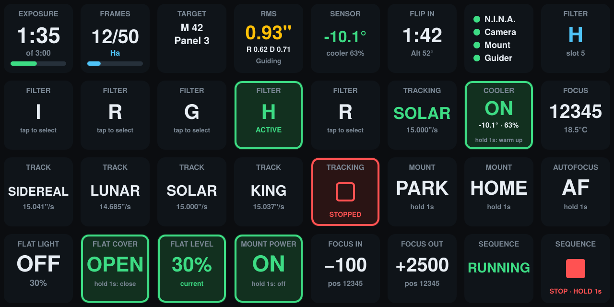
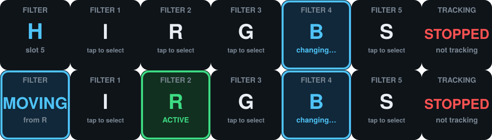
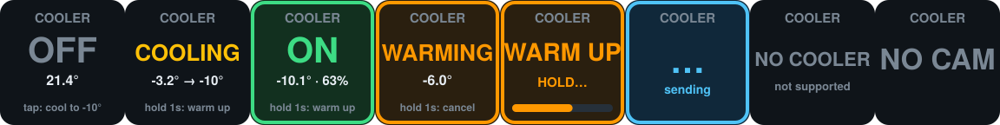
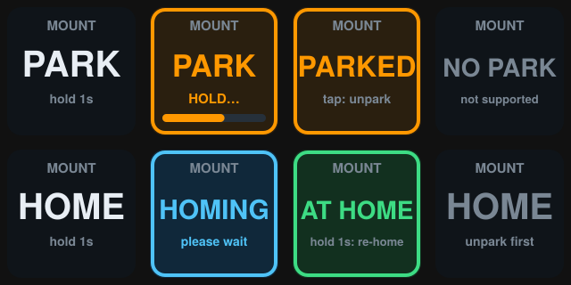
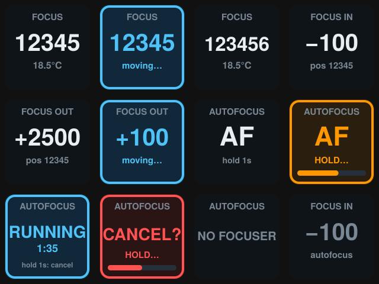
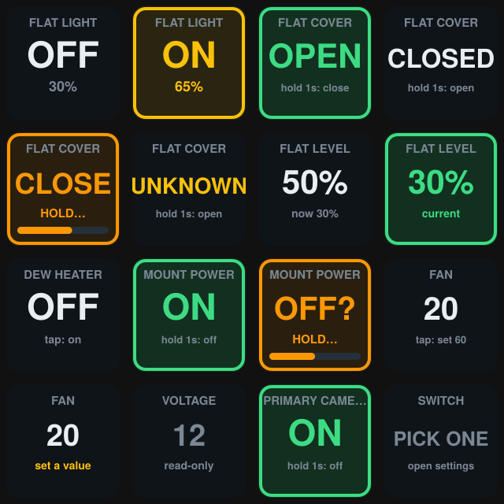
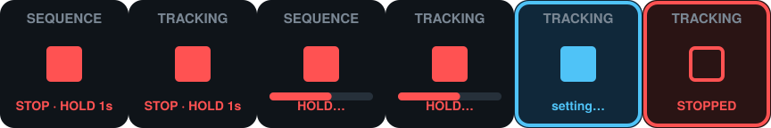

# N.I.N.A. Deck

**A Stream Deck plugin for [N.I.N.A.](https://nighttime-imaging.eu/) (Nighttime Imaging 'N' Astronomy).** Live status keys and safe, one-press controls for your imaging session — exposure countdown, guiding RMS, target, sensor temperature, filters, focuser, mount, flat panel and switches — all on the deck next to your PC.



> Unofficial project. Not affiliated with or endorsed by N.I.N.A., PHD2 or Elgato.

## Features

**Live status**
- Exposure countdown with progress bar, frame count (`12/50` plus the filter), and the current or next target
- PHD2 guiding RMS in arcseconds with colour coding (green / yellow / red) and RA / Dec breakdown
- Sensor temperature and cooler power, time to meridian flip, and a connections key (N.I.N.A., camera, mount, guider)
- Current filter, tracking mode / rate, focuser position and temperature

**Controls**
- **Sequence:** Start, and Stop (hold to confirm)
- **Filters:** one configurable *Select Filter* key — drag it out as many times as you like and pick the filter for each key from a drop-down filled from your wheel
- **Mount:** tracking rate (Sidereal / Lunar / Solar / King), Stop tracking, Park / Unpark, Home
- **Camera:** Sensor Cooling toggle with a gradual warm-up
- **Focuser:** Focus In / Out with a per-key step size, and Autofocus (start and cancel)
- **Flat panel:** light on/off, cover open/close, brightness presets
- **Switches:** one key per switch, picked in the key's settings

**Built to be safe at 2 a.m.**
- Anything that moves hardware or could cost you data needs a **1-second hold** (stop sequence, stop tracking, park, home, open/close the flat cover, warm the camera, start/cancel autofocus, turn a switch off).
- Actions that would ruin a frame — filter changes, tracking changes, focus moves, park/home, cover moves, turning the flat light on — are **refused while the camera is exposing** (the key flashes an alert).
- After a command, the key **re-reads the device and alerts if it didn't take**, instead of assuming it worked.
- Slow operations (parking, homing, focusing, cover moves) show a "please wait" state until the device reports it has finished.

## Requirements

- Windows 10 or later with N.I.N.A. running on the **same PC** as Stream Deck (works on any Stream Deck model; layouts shown here are for the XL)
- Stream Deck software 6.9 or later
- The N.I.N.A. **Advanced API** plugin ([christian-photo/ninaAPI](https://github.com/christian-photo/ninaAPI)), installed and enabled in N.I.N.A., listening on the default port `1888`
- Optional: PHD2 (for the guiding key — it reads PHD2's data through N.I.N.A.)

## Install

1. In N.I.N.A., install and enable the **Advanced API** plugin (*Plugins → Available*), then restart N.I.N.A.
2. Download `com.sirsnacks.ninadeck.streamDeckPlugin` from the [Releases](../../releases) page and double-click it. Stream Deck installs it.
3. In the Stream Deck app, open the **N.I.N.A. Deck** category on the right and drag keys onto your deck.

Quick check that the API is reachable: open `http://localhost:1888/v2/api/equipment/camera/info` in a browser — you should see JSON. If a key shows **OFFLINE**, the plugin can't reach the API.

## Keys

| Key | What it does |
|---|---|
| **Exposure Countdown** | Time remaining in the current exposure, with a progress bar |
| **Frame Count** | Frames done / total, plus the filter |
| **Target** | Current (or next) target name from the running sequence |
| **Guiding RMS** | PHD2 RMS in arcseconds, colour-coded |
| **Sensor Temp** | Camera temperature and cooler power |
| **Meridian Flip** | Time until the flip, and altitude |
| **Connections** | N.I.N.A., camera, mount and guider status |
| **Start Sequence** | Starts the loaded sequence |
| **Stop Sequence** | Hold 1 s to stop the sequence |
| **Current Filter** | The filter in the beam (shows "changing…" while the wheel moves) |
| **Select Filter** ⚙ | Changes to the filter chosen in this key's settings; highlights when active |
| **Tracking Rate** | Current tracking mode and rate |
| **Track: Sidereal / Lunar / Solar / King** | Sets the mount tracking rate |
| **Track: Stop** | Hold 1 s to stop mount tracking |
| **Sensor Cooling** ⚙ | Cooler off → tap to cool to the target temperature (default −10 °C). Cooler on → hold 1 s to warm up gradually; hold again to cancel |
| **Park Mount** | Hold 1 s to park; when parked it shows PARKED and a tap unparks |
| **Home Mount** | Hold 1 s to send the mount home (needs an unparked mount) |
| **Focus Position** | Current focuser position and temperature |
| **Focus In / Focus Out** ⚙ | Move the focuser by this key's step size (default 100) |
| **Autofocus** | Hold 1 s to start; hold again to cancel while it runs |
| **Flat Light** | Tap to toggle the flat panel light |
| **Flat Cover** | Hold 1 s to open or close the cover |
| **Flat Brightness** ⚙ | Tap to set the panel to this key's preset (0–100 %) |
| **Switch** ⚙ | Pick a switch in settings. On/off switches: tap = on, hold 1 s = off. Ranged switches set the value you choose |

⚙ = has a settings panel (select the key in the Stream Deck app to open it).

### Screenshots

| | |
|---|---|
|  |  |
|  |  |
|  |  |

*Key images are renders of the plugin's own SVG output from its test suite.*

## Good to know

- **Polling:** the plugin polls the API (camera every second, guider and filter wheel / focuser / flat panel / switches every two, mount every five, the sequence every three). Keys repaint once a second.
- **Guiding colours:** green up to 0.8″, yellow up to 1.5″, red above. Change `RMS_GOOD` / `RMS_OK` at the top of `src/core/render.ts` and rebuild.
- **Different port:** the API address is set in `src/core/store.ts` (`BASE`); change it and rebuild.
- **Logs:** refused and failed commands are written to the plugin log (Stream Deck → Preferences → Plugins, or the plugin's logs folder).
- **Autofocus status:** the API has no "autofocus running" flag, so the key tracks it itself, and N.I.N.A. can only cancel an autofocus that was started through the API.
- **Devices that aren't connected** show a dimmed "NO …" key (for example NO FOCUSER) rather than an error.

## Status

The plugin was developed against N.I.N.A. with the Advanced API using ASCOM simulators and recorded real API responses, and its logic is covered by automated tests (see below). It has had limited testing on real equipment, so treat the first real-hardware session as a test and keep an eye on the deck. Reports from real setups are very welcome — please include the plugin log and the relevant `curl` output from the API.

## Build from source

```bash
npm install
npm test        # mock N.I.N.A. server, rendering, settings panels (jsdom), manifest consistency
npm run build   # bundles the plugin into com.sirsnacks.ninadeck.sdPlugin/
npx @elgato/cli validate com.sirsnacks.ninadeck.sdPlugin
npx @elgato/cli pack com.sirsnacks.ninadeck.sdPlugin -o dist
```

Layout:

```
src/core/       pure logic: API parsing, polling store, SVG key renderers, command planning (no Stream Deck imports)
src/actions/    thin Stream Deck action classes (keys)
src/ui/         settings-panel scripts
com.sirsnacks.ninadeck.sdPlugin/   manifest, images, settings-panel HTML, built bundles
test/           unit tests, mock server, fixtures of real API responses
```

Built with the [Stream Deck SDK](https://docs.elgato.com/streamdeck/sdk/) (TypeScript, Node.js 20).

## API endpoints used

All via the Advanced API at `http://localhost:1888/v2/api` (GET):

`/sequence/json|start|stop` · `/equipment/camera/info|cool|warm` · `/equipment/guider/info|graph` · `/equipment/mount/info|tracking|park|unpark|home` · `/equipment/filterwheel/info|change-filter` · `/equipment/focuser/info|move|auto-focus` · `/equipment/flatdevice/info|set-light|set-cover|set-brightness` · `/equipment/switch/info|set`

API reference: [Advanced API documentation](https://bump.sh/christian-photo/doc/advanced-api).

## Changelog

See [CHANGELOG.md](CHANGELOG.md).

## License

<!-- Add a LICENSE file and name it here before publishing, e.g. "MIT — see LICENSE". -->
